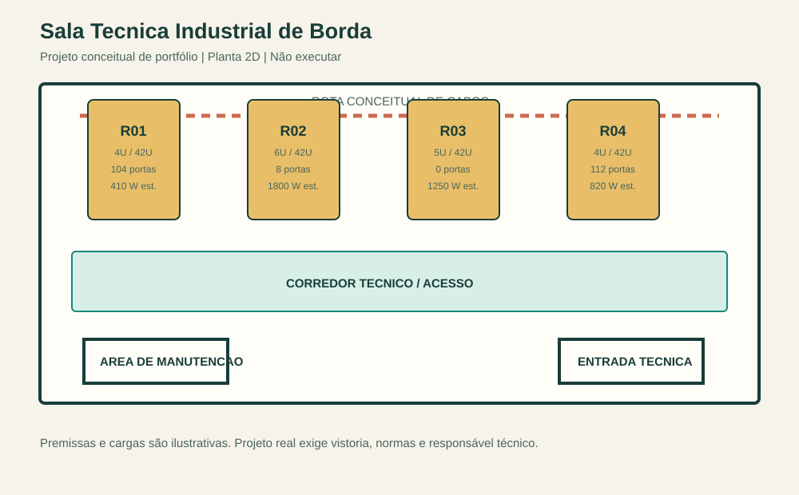

# Portfólio Conceitual: Sala Técnica Industrial de Borda

Projeto autoral para demonstrar raciocínio de projeto, documentação técnica 2D, AutoCAD, organização de dados e automação simples com Python.

> Cenário didático: uma sala técnica de borda para uma operação industrial. O foco não é vender equipamentos nem reproduzir um projeto de fabricante, e sim demonstrar como transformar requisitos em documentação rastreável.



## Aviso importante

Este é um **projeto conceitual de portfólio**. Não é um projeto executivo, não foi homologado por fabricante e não deve ser usado para instalação, compra, obra, dimensionamento elétrico, prevenção contra incêndio ou execução em campo. Um projeto real exige vistoria, requisitos do cliente, normas aplicáveis, memorial de cálculo, responsabilidade técnica e revisão por profissionais habilitados.

## Por que este projeto existe

Uma sala técnica concentra infraestrutura de rede, computação, energia e cabeamento. Mesmo em uma proposta pequena, um bom projeto precisa deixar claros o layout, as premissas, os equipamentos, as interfaces entre disciplinas e o que ainda precisa ser validado.

O projeto demonstra quatro competências:

- **Desenho técnico:** planta 2D em milímetros, racks, rota conceitual de cabos, área de manutenção e anotações.
- **Organização:** separação entre fonte de dados, script, desenho e entregáveis.
- **Automação:** um inventário CSV gera a lista de materiais, resumo de capacidade, DXF, SVG e página de apresentação.
- **Responsabilidade profissional:** limitações explícitas, ausência de marcas e rejeição de qualquer uso como desenho para obra.

## Como funciona

```text
dados/equipamentos.csv
          |
          v
scripts/gerar_portfolio.py
   |        |         |         |
   v        v         v         v
 BOM CSV  resumo MD  DXF/SVG  apresentacao HTML
```

1. O arquivo CSV concentra item, rack, unidades de rack, portas e potência ilustrativa.
2. O script valida se a ocupação de cada rack ultrapassa 42U.
3. O script consolida totais por rack e gera os artefatos de apresentação.
4. O DXF pode ser aberto e estudado no AutoCAD, mas nenhum AutoCAD é necessário para ver o portfólio: o SVG e a página HTML abrem no navegador.

Leia também:

- [Decisões de projeto](docs/decisoes_de_projeto.md)
- [Guia de estudo e apresentação](docs/guia_de_estudo.md)

## Conteúdo

- `dados/equipamentos.csv`: fonte de dados do inventário conceitual.
- `scripts/gerar_portfolio.py`: gera os entregáveis com a biblioteca padrão do Python.
- `entregaveis/planta_conceitual.dxf`: desenho 2D em DXF ASCII, editável no AutoCAD.
- `entregaveis/planta_conceitual.svg`: prévia leve do desenho.
- `entregaveis/lista_materiais.csv`: lista de materiais conceitual.
- `entregaveis/resumo_capacidade.md`: resumo de ocupação, portas e carga estimada.
- `entregaveis/apresentacao.html`: página pronta para abrir no navegador e imprimir em PDF.
- `entregaveis/roteiro_entrevista.md`: fala curta e pontos técnicos para a entrevista.

## Requisitos para estudar o projeto

- Nenhuma instalação de AutoCAD é necessária.
- Para visualizar: navegador moderno.
- Para regenerar os arquivos: Python 3.10 ou superior, sem bibliotecas externas.
- Para editar o desenho: AutoCAD ou outro editor que suporte DXF ASCII.

## Como gerar

No PowerShell, dentro desta pasta:

```powershell
py .\scripts\gerar_portfolio.py
```

Caso o comando `py` não exista:

```powershell
python .\scripts\gerar_portfolio.py
```

## Como apresentar

1. Abra `entregaveis/apresentacao.html` no navegador.
2. Use `Ctrl+P` e selecione **Salvar como PDF**.
3. Leve o PDF e o arquivo DXF em um pendrive ou armazenamento em nuvem.
4. Explique que o objetivo foi demonstrar método: premissas, layout, rastreabilidade, quantitativos e validação de dados.

## Perguntas que o repositório responde

- **Por que quatro racks?** Para exemplificar separação lógica entre acesso, computação, energia e núcleo de rede em uma escala pequena e compreensível.
- **Por que Python?** Para evitar que inventário, quantitativos e desenho sejam atualizados manualmente e fiquem inconsistentes.
- **Por que não há marca de fabricante?** Porque o portfólio demonstra método de engenharia; uma seleção real depende de requisitos, contrato e catálogo homologado.
- **O desenho pode ir para obra?** Não. Ele é propositalmente limitado a uma representação didática.

## O que este projeto demonstra

- Documentação 2D organizada em milímetros.
- Separação visual entre arquitetura, racks, rota de cabos e anotações.
- Rastreabilidade entre desenho e lista de equipamentos.
- Cálculo automatizado de ocupação de rack, portas e carga estimada.
- Comunicação técnica em formato objetivo, com escopo e limitações explícitos.
